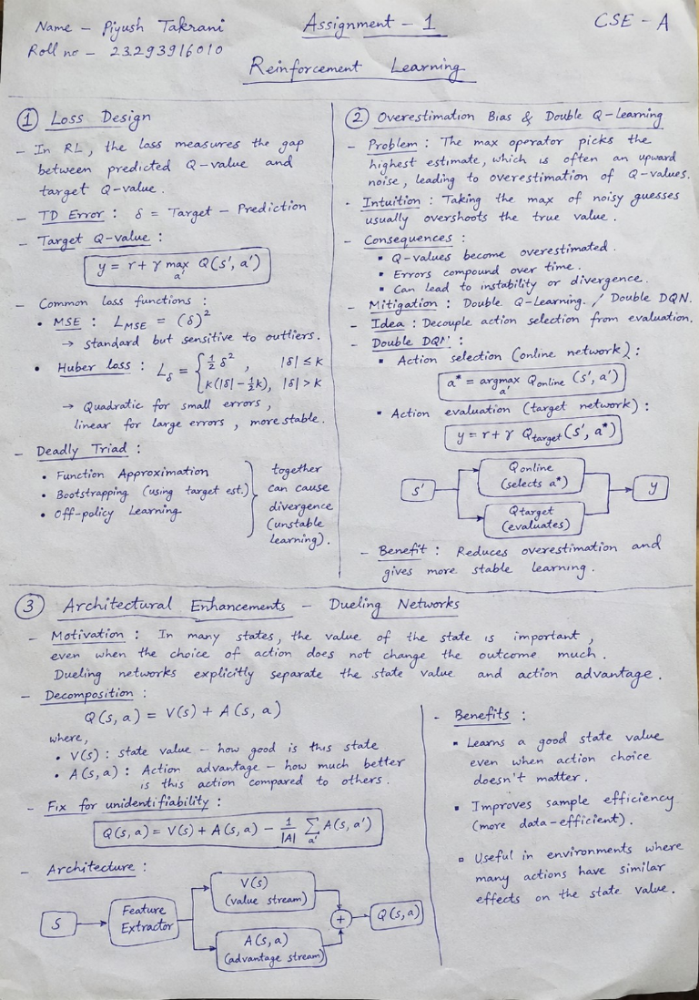
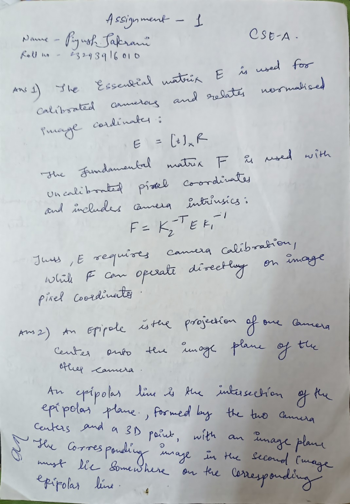

<div align="center">

# Handwrite

**Turn assignments, notes, and PDFs into handwritten notebook pages.**

Portable Agent Skill · source-first workflow · optional handwriting reference

[](https://github.com/chotushikari/handwrite-agent-skill/actions)
[](LICENSE)

</div>

Handwrite tells a compatible agent how to read an assignment, plan its pages, preserve the content, and render each page as a readable notebook image.

It is a **skill, not an image generator**. Rendering requires a native image tool or a configured image provider.

## What you provide → what you get

<table>
<tr>
<td width="50%" align="center"><strong>1. Provide a reference</strong></td>
<td width="50%" align="center"><strong>2. Get notebook pages</strong></td>
</tr>
<tr>
<td align="center"></td>
<td align="center"></td>
</tr>
<tr>
<td align="center">Your assignment plus an optional handwriting sample</td>
<td align="center">One portrait page image at a time</td>
</tr>
</table>

> These images demonstrate the reference-to-output workflow. They contain different subject matter and are not a same-content before/after pair.

## How to use it

### 1. Copy the skill

```bash
git clone https://github.com/chotushikari/handwrite-agent-skill.git
```

Copy this complete folder into the Agent Skills directory used by your tool:

```text
skills/handwrite-assignment/
├── SKILL.md
├── references/
└── assets/
```

| Tool | Typical location |
| --- | --- |
| Claude Code | `~/.claude/skills/handwrite-assignment/` |
| OpenAI Codex | `~/.agents/skills/handwrite-assignment/` |
| VS Code / GitHub Copilot | `.github/skills/handwrite-assignment/` or `.agents/skills/handwrite-assignment/` |
| Other tools | Use that tool's documented Agent Skills location |

Do not copy only `SKILL.md`; the references and assets are part of the skill.

### 2. Add the source and reference

Attach:

- the assignment, notes, PDF, DOCX, screenshot, photo, or pasted text;
- optionally, one to three clear photos of the handwriting style you want to follow.

The source provides the content. The handwriting photo provides style only. Do not include private information you do not want sent to the configured image provider.

### 3. Add an image renderer

Choose one:

- a native image-generation tool provided by your agent host; or
- the optional [`mcp-image-provider/`](mcp-image-provider/) bridge.

Without a renderer, the skill can still audit the source, make the page plan, and return exact render prompts. It cannot create image files by itself.

### 4. Start with this prompt

```text
Use the handwrite-assignment skill.
Read the complete source before generating anything.
Create a coverage checklist and page plan first.
Use my attached notebook photo only as a handwriting-style reference.
Preserve the source meaning, equations, diagrams, tables, and question order.
Create one portrait A4-like notebook page per image.
Keep the handwriting natural and readable.
Generate page 1 first so I can review it.
```

### 5. Review before continuing

Use the same chat to control the next pages:

| Say this | Result |
| --- | --- |
| `Make it more irregular` | Add natural variation while keeping the text readable |
| `Make it neater` | Improve spacing and legibility |
| `Fix this page: ...` | Correct a specified error |
| `Continue with page 2` | Generate the next page without repeating the title block |
| `Check content` | Compare the pages with the original source |

Save the images. Combine them into a PDF if you need one submission file.

## What the skill enforces

- Read the complete source before rendering.
- Track every question, sub-question, equation, diagram, and constraint.
- Split dense content across pages instead of shrinking it.
- Keep continuation pages consistent without repeating the header.
- Preserve technical content; never invent missing facts or student details.
- Inspect for omissions, clipping, unreadable text, and incorrect labels.
- State clearly when no renderer is available.

## Default output

- Portrait A4-like page
- Blue ballpoint ink
- Readable student-style handwriting
- Slightly irregular letters, spacing, and baselines
- Simple blue-ink diagrams and tables
- No coloured highlights unless requested

## Repository

```text
skills/handwrite-assignment/   Core skill instructions and references
mcp-image-provider/            Optional MCP image-rendering bridge
docs/                          Rendering and portability guides
evals/                         Scenario-based evaluation cases
scripts/validate_skill.py      Local validator
```

Run the local validation:

```bash
python scripts/validate_skill.py
```

## Troubleshooting

- **Skill not recognised:** verify that `handwrite-assignment/SKILL.md` exists directly inside the copied folder, then reload the host.
- **No image files:** configure a native renderer or the optional MCP provider.
- **Pages are crowded:** ask for more pages; do not ask the agent to make the writing smaller.
- **Writing is too uniform:** attach a clearer handwriting reference and request more natural variation.

## Documentation

- [Core skill](skills/handwrite-assignment/SKILL.md)
- [Image rendering](docs/IMAGE_RENDERING.md)
- [Portability](docs/PORTABILITY.md)
- [MCP image provider](mcp-image-provider/README.md)

## License

Apache-2.0. See [LICENSE](LICENSE).
