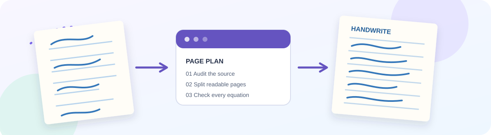
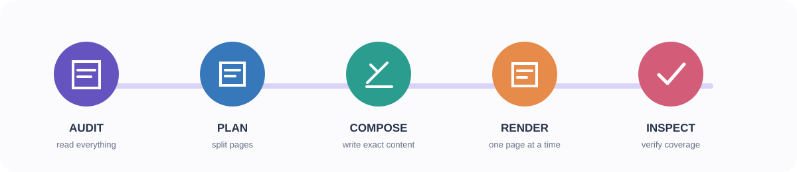
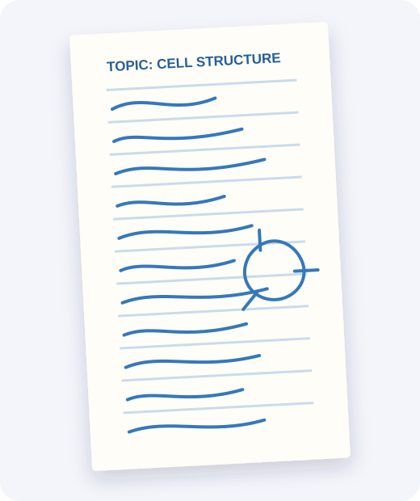

<div align="center">



# Handwrite

### Turn academic material into readable, natural-looking handwritten notebook pages.

An open, portable [Agent Skill](https://agentskills.io/) for auditing source material, planning pages, composing accurate content, and rendering student-style notebook images.

[](https://agentskills.io/)
[](https://github.com/chotushikari/handwrite-agent-skill/actions)
[](LICENSE)

<br>

**Read first. Plan carefully. Render honestly.**

</div>

---

## What is Handwrite?

Handwrite gives an AI agent a disciplined workflow for turning assignments, notes, PDFs, screenshots, and typed questions into a sequence of handwritten notebook-page images.

It targets **ordinary student handwriting**: readable, technically accurate, and mildly irregular rather than calligraphic or generated from a perfect handwriting font.

### What it handles

- Audits the complete source before writing anything.
- Tracks every requested question, sub-question, equation, diagram, and constraint.
- Splits dense material across realistic portrait pages.
- Keeps a consistent casual blue-ballpoint style across continuation pages.
- Uses reference handwriting for visual guidance without copying unrelated content.
- Checks coverage, legibility, clipping, equations, and page consistency.
- Uses the host's native image tool or a connected image provider.
- Falls back to exact render-ready prompts when no renderer is available.

## See the workflow

<div align="center">



</div>

1. **Audit** the entire source and build a coverage checklist.
2. **Plan** page breaks around readable writing capacity.
3. **Compose** exact page content before calling an image renderer.
4. **Render** one portrait page at a time through the host or MCP provider.
5. **Inspect** the result and regenerate pages with missing, clipped, or garbled content.

## The visual target

| Detail | Default behavior |
| --- | --- |
| Writing instrument | Casual blue ballpoint |
| Handwriting | Readable, semi-cursive, mildly irregular |
| Layout | Portrait A4-like page with modest whitespace |
| Diagrams | Simple, hand-drawn, blue ink |
| Paper | Off-white or white with subtle texture |
| Camera feel | Full page visible, soft shadow, slight phone-camera perspective |
| Colour policy | Blue ink only; no coloured highlights by default |
| Quality bar | Natural variation must never obscure the content |

<div align="center">



<sub>Illustrative style preview. The skill does not ship a fixed handwriting font or image model.</sub>

</div>

## Quick start

### 1. Install the skill

The portable skill folder is [`skills/handwrite-assignment/`](skills/handwrite-assignment/).

<details>
<summary><strong>Claude Code</strong></summary>

```bash
mkdir -p ~/.claude/skills
cp -R skills/handwrite-assignment ~/.claude/skills/
```

</details>

<details>
<summary><strong>OpenAI Codex</strong></summary>

```bash
mkdir -p ~/.agents/skills
cp -R skills/handwrite-assignment ~/.agents/skills/
```

</details>

<details>
<summary><strong>Gemini CLI or another compatible agent</strong></summary>

Use the host's documented Agent Skills directory or import flow, then copy:

```text
skills/handwrite-assignment/
```

</details>

### 2. Add an image renderer

The skill is provider-neutral. Use either:

1. the host's native image-generation tool; or
2. the included [MCP image provider](mcp-image-provider/), which bridges to an OpenAI Images API-compatible endpoint.

For MCP setup, see [`mcp-image-provider/README.md`](mcp-image-provider/README.md). For provider boundaries and the fallback behavior, see [`docs/IMAGE_RENDERING.md`](docs/IMAGE_RENDERING.md).

### 3. Start an assignment

After installation, give your agent a source file and a request like this:

```text
Use Handwrite to turn this assignment into handwritten notebook pages.
Read the entire source first and create a topic coverage checklist.
Split the material into readable portrait pages and generate each page in order.
Use casual blue-ballpoint student handwriting with natural irregularity.
Do not repeat the title or student details on continuation pages.
```

## Conversation controls

| Command | Result |
| --- | --- |
| `START ASSIGNMENT` | Inspect the source and prepare the page plan |
| `GENERATE PAGE 1` | Render the first planned page |
| `NEXT PAGE` | Render the next page in sequence |
| `CONTINUE WITHOUT HEADER` | Continue without repeating title/details |
| `MAKE IT MORE IRREGULAR` | Increase variation while preserving readability |
| `MAKE IT NEATER` | Reduce variation without creating typeset perfection |
| `REMOVE HIGHLIGHTS` | Enforce blue ink only |
| `FIX THIS PAGE` | Correct a page while preserving the established style |
| `CHECK CONTENT` | Compare rendered pages with the original requirements |

## Important capability boundary

**Handwrite is an instruction package, not an image model.** A compatible host or connected provider must perform the pixel generation.

If no renderer is available, the correct behavior is still useful and explicit:

- audit the source;
- create the page plan and coverage checklist;
- compose exact page-ready content;
- return a complete prompt for each page; and
- clearly say that no image was rendered.

It must never claim that an image was generated when no renderer ran.

## Repository map

```text
skills/handwrite-assignment/
├── SKILL.md                         # Core workflow and output contract
├── references/                      # Style, planning, rendering and QA guidance
└── assets/page-brief-template.md    # Prompt template for each page

mcp-image-provider/
├── src/index.ts                     # Minimal MCP image-generation bridge
└── README.md                        # Setup, configuration and limitations

docs/
├── IMAGE_RENDERING.md               # Provider integration and fallback rules
└── PORTABILITY.md                   # Host compatibility and installation notes

evals/                               # Scenario-based behavior checks
scripts/validate_skill.py            # Frontmatter and structure validator
```

## Validate locally

```bash
python scripts/validate_skill.py
```

The repository also includes scenario-based evaluations for source coverage, continuation pages, visual style, and missing-renderer behavior. CI runs the validator on pushes and pull requests.

## Safety and privacy

- Do not invent personal details, institutional information, dates, citations, equations, or source facts.
- Treat uploaded source files and reference images as user-provided content.
- Do not copy private or unrelated text from a handwriting reference image.
- Keep provider API keys in the host's secret manager or environment variables.
- Do not commit generated private student work or credentials.
- Make generated pages available only to the user unless they explicitly request sharing.

## Compatibility

The skill uses the open Agent Skills folder convention. Installation and image rendering remain host-specific; see [`docs/PORTABILITY.md`](docs/PORTABILITY.md) before claiming support for a product or model.

## Contributing

Ideas, fixes, new host integrations, and evaluation cases are welcome. Read [`CONTRIBUTING.md`](CONTRIBUTING.md) before opening an issue or pull request. Never include private student records, reference images, or API keys in issues.

## License

Apache-2.0. See [`LICENSE`](LICENSE).

<div align="center">

<sub>Built for agents that value source fidelity, readable pages, and honest capability boundaries.</sub>

</div>
